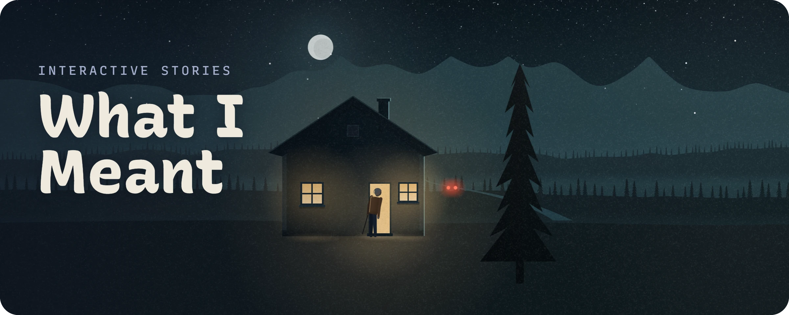
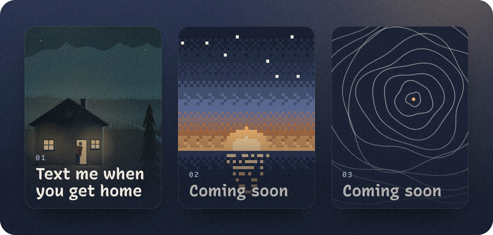
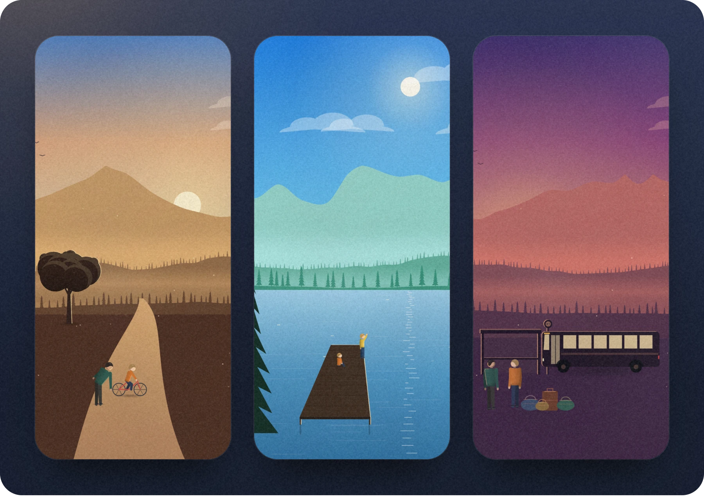

  

  Sometimes it's too hard to put into words, so it's my attempt to show it.

  

 

  

  More stories coming soon.

 

<h3 align="center">01 · Text me when you get home</h3>

  

  

 

  The code: <a href="LICENSE">MIT License</a>. The stories: all rights reserved.

